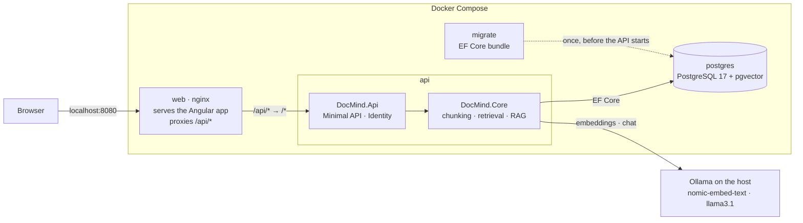

# DocMind

[](https://github.com/Dario-Murillo/DocMind/actions/workflows/ci.yml)

DocMind is a self-hosted document Q&A app built on Retrieval-Augmented Generation (RAG). You create notebooks, upload PDFs to them and ask questions: a local LLM answers using only the passages retrieved from that notebook's documents, and every answer shows the passages it was based on. It runs entirely on your machine — a .NET 9 API, an Angular 22 UI, PostgreSQL with pgvector, and [Ollama](https://ollama.com) for the models — with no API keys or paid services.

<!-- Demo GIF goes here:  -->

## Features

- **Notebooks** — group related documents. A question only searches the documents in its notebook.
- **Conversations with sources** — chats are kept between sessions, and each answer lists the passages it used, with an excerpt and a link to the original PDF. The excerpt stays even after the document is deleted.
- **Per-user isolation** — every query filters by owner. Another user's notebook, document or conversation returns 404, exactly like one that doesn't exist.
- **All-or-nothing indexing** — a PDF is fully chunked and embedded before anything is written. If Ollama fails halfway, nothing is stored. Uploading the same file twice to a notebook is detected by its SHA-256 hash.
- **Fully local** — embeddings (`nomic-embed-text`) and answers (`llama3.1`) come from Ollama on your own machine.

## Architecture



How a question is answered:

1. The question is embedded with `nomic-embed-text`.
2. pgvector finds the most similar chunks in the notebook (cosine distance), filtered by notebook and owner.
3. `llama3.1` answers from a prompt that contains only those chunks.
4. The question, the answer and its sources are stored together in one transaction.

## Run with Docker

### Requirements

- [Docker](https://www.docker.com/products/docker-desktop/) (Docker Desktop on Windows and macOS).
- **[Ollama](https://ollama.com) installed and running on the host — required.** It isn't containerized: `llama3.1` is a ~5 GB download and runs much faster on the host's GPU. Pull both models once:

  ```bash
  ollama pull nomic-embed-text
  ollama pull llama3.1
  ```

  On **Linux**, Ollama only listens on `127.0.0.1` by default, which containers can't reach. Set `OLLAMA_HOST=0.0.0.0` for the Ollama service (for example with `sudo systemctl edit ollama`, adding `Environment="OLLAMA_HOST=0.0.0.0"` under `[Service]`) and restart it.

### Start

From the repository root:

```bash
docker compose --profile app up -d --build
```

Open **http://localhost:8080** and create an account. The first build takes a few minutes. The `migrate` service applies the database migrations and exits; the API only starts once it succeeds.

- The first question after Ollama loads `llama3.1` can take a minute or two, longer if the model runs mostly on the CPU. Answers time out after four minutes.
- Stop everything with `docker compose --profile app down`. Add `-v` to also delete the database and the session keys.

## Development setup

Requirements: the [.NET 9 SDK](https://dotnet.microsoft.com/download), [Node.js 24](https://nodejs.org) with npm 11, Docker, and Ollama with the two models above.

Start only the database and run the API from the repository root:

```bash
docker compose up -d
dotnet tool restore
dotnet run --project DocMind.Api
```

Without `--profile app`, Compose starts just PostgreSQL, on host port `5433`. In development the API applies pending migrations on startup and listens on `http://localhost:5276`, with interactive API docs at `/scalar/v1`.

Then run the UI in a second terminal:

```bash
cd DocMind.UI
npm install
npm start
```

Open `http://localhost:4200` — as `localhost`, not `127.0.0.1`, or the session cookie won't reach the API. The Docker stack and the development setup share the same database.

## Running tests

```bash
dotnet test                                  # backend; needs Docker running
dotnet test --filter "Category!=Integration" # skips the tests that need Ollama
cd DocMind.UI && npm test                    # frontend (Vitest)
```

The backend tests start a disposable PostgreSQL container through Testcontainers, so they never touch the development database. On every pull request, GitHub Actions builds and tests the backend (without the Ollama tests), checks the UI's formatting, runs its tests and production build, and builds the Docker images.

## Design decisions

- **One PostgreSQL database for documents, files and vectors.** A document, its PDF (`bytea`) and its embeddings (`vector(768)`) are written in one transaction, deleted together through cascades and filtered by owner in the same query. A separate vector database would be a second store to keep in sync.
- **Indexing is all-or-nothing.** Every embedding is generated before anything is written, then a single `SaveChanges` stores the document, its file and its chunks. There is no "processing" status: a stored document is always complete.
- **Ownership is checked in every query.** Queries filter by both the record's id and the user's id, so another user's data behaves exactly like missing data (404, never 403). Vector search filters by owner too, so a bug in another layer can't leak someone else's chunks.
- **Answer sources are copies.** Each source keeps the file name and a short excerpt, so a conversation still shows where an answer came from after the document is deleted; only the download link goes away.
- **Same origin behind nginx, with an `/api` prefix.** The UI and the API share one origin, so the session lives in an HttpOnly cookie without CORS in production. The prefix keeps API routes such as `/notebooks/{id}` from clashing with the app's own routes when a page is reloaded.

For conventions, the full command reference and more decisions, see [CLAUDE.md](CLAUDE.md).

## License

[MIT](LICENSE)
